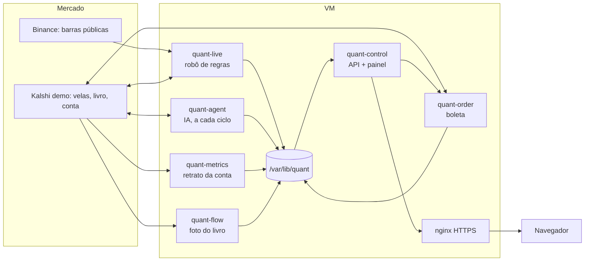

# Arquitetura

## Duas metades

1. **Pesquisa** (no computador): dados → estratégia → backtest → validação → relatório em `estudos/`.
2. **Operação** (na VM): a mesma estratégia, alimentada por barras ao vivo, enviando ordens para a demo.

A estratégia é um único código (`quant.strategies`). O que muda entre backtest e operação é o destino das ordens.

## Princípios

- **O painel não tem a chave da corretora.** Ele grava pedidos validados e dispara um serviço que tem a chave.
- **Conversa por arquivos.** Os processos trocam estado em `/var/lib/quant`; não há banco de dados.
- **A corretora é a fonte da verdade** para posições.
- **Padrão seguro:** sem configuração, o robô roda em `paper`. Pelo painel não se liga `live`.
- **Travas no código**, não no prompt da IA.

## Quem usa a chave

| Processo | Chave da corretora | Chave da IA |
|---|---|---|
| `quant-live`, `quant-agent`, `quant-order`, `quant-metrics` | sim | só o agente |
| `quant-flow` (leitura pública) | não | não |
| `quant-control` (painel) | não | não |
| `quant-portfolio` (paper) | não | não |

Os segredos ficam em arquivos na VM (`/etc/quant-live.env`, `/etc/quant/`), gravados pelo dono. Nunca no git.

## Arquivos de estado (`/var/lib/quant`)

| Caminho | Conteúdo | Quem escreve |
|---|---|---|
| `runtime.env` | parâmetros salvos pelo painel (sem segredos); vencem o `.env` | painel |
| `live_state.<ATIVO>.json` | posição, stop, risco e última leitura de cada ativo | robô |
| `trades.csv` | cada operação fechada (origem, lado, preços, resultado, motivo) | robô, IA, boleta |
| `KILL` | presença dele fecha tudo e para o robô | painel ou terminal |
| `agent/config.json`, `agent/decisions.jsonl` | configuração e diário da IA | painel, IA |
| `metrics/metrics.json`, `equity.jsonl`, `fills.jsonl` | retrato da conta, curva e execuções | métricas |
| `flow/AAAA-MM-DD.csv` | fotos do livro de ofertas | fluxo |
| `deploy.json`, `inbox/`, `backups/` | publicação e reversão | deploy |
| `users.json`, `sessions.json`, `audit.log` | contas do painel | painel |
| `portfolio_state.json`, log CSV | paper da carteira diária | portfolio |
| `selfcheck.json` | última autoverificação | selfcheck |
