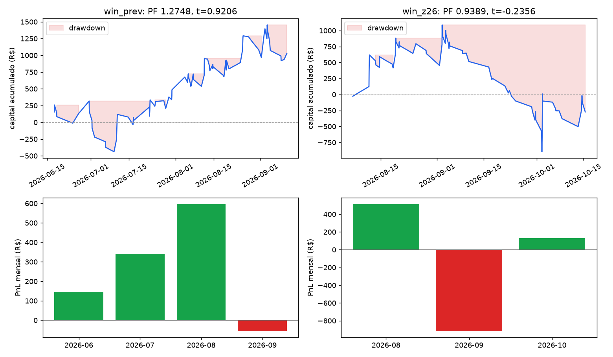

# win_trend — tendência intradiária no WIN

**Status: inconclusivo, sem edge demonstrado. Não promover para `execucao/`.**

Hipótese: no mini índice, rompimento do canal Donchian na direção da tendência (EMA 9/21) só vale a pena quando o
mercado está em regime direcional (Efficiency Ratio de Kaufman ≥ 0,5); em lateralização o filtro tira o robô do jogo.

```bash
python estudos/win_trend/run_backtest.py     # gera reports/summary.json, tearsheet.png, trades_*.csv
```

## Estratégia (parâmetros fixados antes dos dados novos; nada foi reotimizado)

| Item | Valor |
|---|---|
| Regime | ER(20) ≥ 0,5 |
| Tendência | EMA 9 > EMA 21 (compra) / < (venda) |
| Gatilho | fechamento rompe o Donchian(20) da barra anterior |
| Saída | stop 1,5 × ATR(14); alvo 2 × o stop; zera às 17:50 |
| Sessão de entrada | 09:15–17:45 |
| Custos | 1 tick de slippage no stop/entrada, R$ 1,20 por round-trip, 1 contrato (R$ 0,20/ponto) |

Código: `src/quant/strategies/trend_follow.py` + `src/quant/backtest/engine.py`.

## Resultado (motor realista, só dias líquidos ≥ 60 barras)

| | WIN anterior (15/04–14/09) | WINZ26 (12/05–16/10) |
|---|---|---|
| Dias / trades | 62 / 84 | 47 / 76 |
| Profit factor | 1,27 | **0,94** |
| PnL líquido | R$ 1.028 | **−R$ 273** |
| Drawdown máx. | −R$ 757 | −R$ 1.985 |
| t-stat dos trades | 0,92 | −0,24 |
| P(prejuízo) bootstrap | 19% | 60% |
| PF com custos ×2 / ×3 | 1,20 / 1,14 | 0,89 / 0,85 |
| **DSR** (prob. de edge real), 1 / 20 / 100 tentativas | 0,83 / 0,15 / 0,05 | 0,41 / 0,02 / 0,00 |

Treino (15/04–31/07) PF 1,30 (37 trades) × teste (01/08–14/09) PF 1,25 (47 trades) — consistente, mas as duas
metades somam 84 trades e t < 1.



## Leitura

- **O que o README antigo dizia estava inflado.** Ele reportava PF 1,45–1,58 "fora da amostra" e concluía que o
  filtro "captura algo real". Reexecutando com (1) dias ilíquidos removidos, (2) entrada na abertura seguinte em
  vez de no fechamento do sinal, (3) zeragem às 17:50 e gap atravessando o stop, o PF cai para 1,27 e o t-stat
  fica abaixo de 1. Abril–maio saem da amostra: eram dias esparsos de um contrato sem liquidez.
- **A série mais nova não confirma.** O WINZ26 (outro contrato, vai até 16/10) dá PF 0,94 no total. Só o trecho
  de 15/09 a 16/10 é posterior ao estudo original: 33 trades, PF 0,67, −R$ 789. Poucos trades, mas nenhum sinal de
  que o resultado do WIN anterior se repete.
- **Seleção de parâmetros conta.** O estudo original varreu Donchian × ATR × R:R × EMA e descartou o que não
  generalizou. Com 20–100 variantes olhadas, o DSR desce a 0,15–0,05: o resultado do WIN anterior é compatível com
  sorte de seleção.
- **Amostra:** ~2,5 meses líquidos por série, ~80 trades. Para t ≈ 2 com este edge seriam necessários
  centenas de trades em mais de um regime.

## Limitações

- As duas séries são **contratos diferentes cobrindo as mesmas semanas**: não são amostras independentes.
- Sem volume. Sem dimensionamento por risco. Sem limite de perda diária no motor.
- Barras de 5 min cruzam a noite nos indicadores (ATR/ER incluem o gap da abertura); não há reset diário.

## Próximos passos (só valem com mais dados)

1. 1–2 anos de WIN/WDO, de preferência em 1 min e **com volume**, por contrato.
2. Série contínua com ajuste de rolagem ou, no mínimo, uma série por vencimento líquido.
3. Walk-forward real: só tem sentido com parâmetros ajustados em janela e testados na seguinte
   (`quant.validation.walk_forward_splits`).
4. Antes de implementar qualquer ideia nova, contar a tentativa em `n_trials` do DSR.

Diário das ideias já testadas e descartadas: [`diario.md`](diario.md). Adapter Profit: `execucao/profitpro/`
(porte fiel desta estratégia: `WinTrendBot_v10_fix_ToCover.ntsl`).
